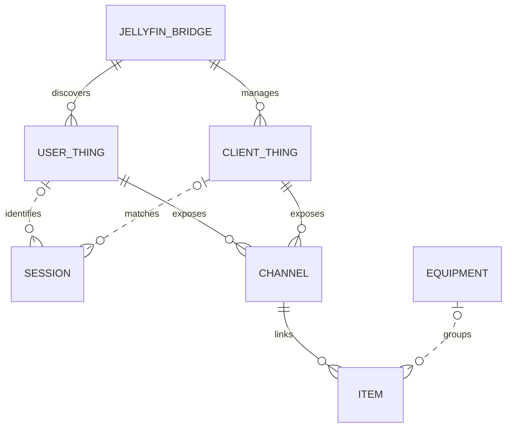
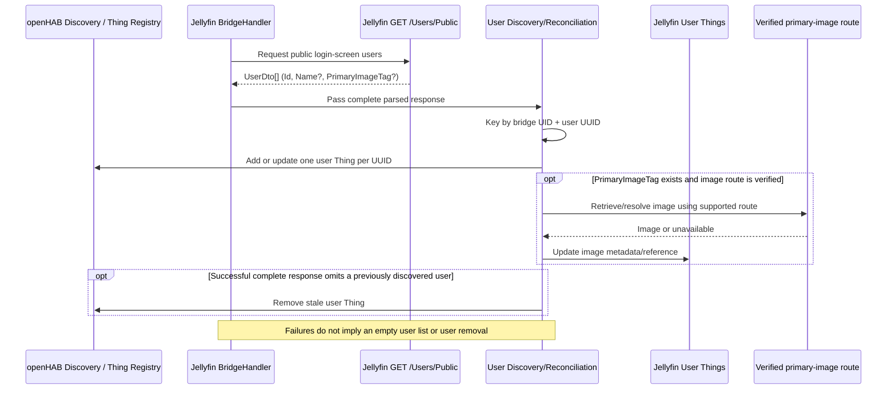

# Jellyfin User Discovery Architecture

**Issue:** openHAB Add-ons #21850  
**Purpose:** Architecture for discovering Jellyfin login-screen users as openHAB Things  
**Status:** Proposed; user discovery and image retrieval require implementation/runtime validation

## 1. Architectural Summary

The Jellyfin binding should discover login-screen accounts through `GET /Users/Public`, not infer them from active client sessions. The bundled Jellyfin OpenAPI 10.11.6 defines this endpoint as returning users publicly visible for display on a login screen. Each returned account is represented by one user Thing under the configured Jellyfin bridge. The Jellyfin user UUID, scoped by bridge identity, is the stable key; the display name is mutable metadata.

User Things are informational and independent of client Things and playback sessions. Existing client Things continue to represent Jellyfin devices/sessions. Where the separate client identity feature is implemented, a client session may reference a Jellyfin user UUID, but session activity does not create or remove user Things.

The API schema provides nullable `Name` and `PrimaryImageTag`. The local OpenAPI specification does not define a user primary-image retrieval route, so image endpoint construction and cache/authentication semantics must be verified against authoritative Jellyfin documentation or a live supported server before implementation. The architecture must not assume a route from the image tag alone.

## 2. Domain and openHAB Entity Relationships

The diagram distinguishes the configured bridge Thing, discovered user/client Things, Jellyfin's transient sessions, and optional openHAB Items/equipment. Dashed edges indicate a logical or optional association, not a required Thing link.

Cardinality notes:

- One bridge can discover zero or many public user Things and manage zero or many client Things.
- A user Thing exists whether or not the account currently has a session. A Jellyfin session may have no usable user ID in a response; when present, its user UUID can identify the corresponding account independently of the session's client device.
- A client Thing may have zero or many sessions over time, matched using the binding's existing device-ID rules. Do not use session association as the user Thing's lifecycle source.
- Thing channels can be linked to zero or many Items according to openHAB's normal linking behavior. Equipment is optional semantic metadata over Items, not a required Jellyfin Thing relationship.

## 3. Discovery and Data Flow

The public user list is a separate source from `GET /Sessions`. Use the generated `UserDto` model and existing bridge HTTP/authentication conventions. Do not parse API response text manually, call the privileged general `/Users` endpoint for this login-screen scope, or make user discovery depend on client polling.

## 4. Components and Responsibilities

| Component | Responsibility | Constraints |
| --- | --- | --- |
| Jellyfin bridge Thing/handler | Owns connection configuration and user discovery lifecycle | Reuse configured server URL, HTTP facilities, authentication, and bridge disposal behavior |
| `GET /Users/Public` | Supplies accounts visible on the login screen | OpenAPI 10.11.6 describes an array of `UserDto`; runtime auth/reverse-proxy behavior still needs verification |
| User discovery/reconciliation | Maps response entries to discovered user Things | Stable key is bridge UID plus Jellyfin user UUID; reconcile only complete successful responses |
| User Thing | Represents one Jellyfin account | Read-only identity/name/image information; no password or account-management commands |
| Profile-image mapping | Resolves optional `PrimaryImageTag` to an openHAB-compatible representation | Route, authentication, cache behavior, and content type must be verified; do not guess URL construction |
| Existing client discovery/session manager | Represents and associates client devices/sessions | Remains unchanged; match session `DeviceId` to client device ID using current canonicalization |
| Optional Items/equipment | Exposes selected Thing channels to rules/UI and semantic model | User Thing channels/properties are not required to be linked; equipment is user-configured and optional |

## 5. Identity and Reconciliation Rules

- Use the Jellyfin `UserDto.Id` UUID as the account identity. Scope Thing identity with the bridge UID so separate servers cannot collide.
- Treat `Name` and `PrimaryImageTag` as optional, nullable values. Missing fields make only their corresponding profile data unavailable; they do not invalidate the user record.
- A changed name or image tag updates the existing user Thing. It must not change the Thing UID or create a duplicate.
- Remove a previously discovered user only after a successful, complete response proves that the user is no longer returned by `/Users/Public`.
- Keep known Things through timeout, transport/API error, malformed response, or partial failure. Such failures do not establish that no users exist.
- Do not expose password fields, policies, authentication tokens, or credentials in Thing properties, discovery results, image references, logs, or exceptions.
- Follow existing openHAB lifecycle patterns: discovery/reconciliation is idempotent; scheduled jobs/listeners are stopped or released on bridge disposal.

## 6. Image Representation and Security Boundary

`PrimaryImageTag` is a nullable API field, not by itself a complete image URL or proof that the image is accessible. The OpenAPI 10.11.6 document inspected for this design does not declare a `/Users/{userId}/Images/...` operation. Before choosing a Thing property or channel, validate:

- The supported Jellyfin primary-user-image endpoint for the binding's supported server versions.
- Whether the endpoint requires bridge credentials or works anonymously, including behind reverse proxies.
- Whether the response is an image resource openHAB can represent/link, or whether a URL/reference is the supported representation.
- Cache behavior and the correct use of the image tag for invalidation without leaking credentials.

If no supported, secure retrieval path is established, expose the image tag only as descriptive metadata or leave the image field unavailable. Do not persist image bytes or embed credentials in a URL as a workaround.

## 7. Relationship to Client Session Identity

The existing client-session investigation concerns optional `user` and `user-id` channels on a client Thing. Those values are a snapshot of the primary user associated with that session; they do not replace the account-level user Thing.

If both capabilities are implemented, a session's primary `UserId` can be correlated with a discovered account Thing by UUID. The relationship is informational and may be absent if the session field is missing or the account is not public. `AdditionalUsers` does not create Things or override the primary user. Existing session and client matching, playback state mapping, and command routing remain unchanged.

## 8. Validation Plan and Open Questions

Tests should cover:

- Mapping a public `UserDto` to one user Thing with a stable bridge-scoped UUID and name.
- Repeated discovery and name/image-tag changes updating, not duplicating, a Thing.
- Missing/null name and image tag leaving the user Thing present while marking only that data unavailable.
- Removal after a complete successful list, and retention after transport, HTTP, parse, or partial-response failure.
- Isolation between two bridge Things that report the same user UUID.
- Profile image behavior only after the supported endpoint, auth, caching, and openHAB representation are verified.
- No changes to existing client discovery, device matching, session updates, playback channels, or commands.

Remaining validation before implementation:

- Confirm generated model nullability and UUID representation for `UserDto.Id`, `Name`, and `PrimaryImageTag`.
- Verify `/Users/Public` authentication behavior against supported Jellyfin server versions; no security requirement is declared for it in the bundled OpenAPI, but deployment/runtime behavior can differ.
- Verify the user image route and image transport contract; the bundled OpenAPI does not define the user-specific image path.
- Decide whether bridge-offline behavior retains last-known user metadata or clears it, consistent with existing discovery and Thing lifecycle conventions.

## 9. Source Documents

- [Feature specification](jellyfin-issue-21850-feature-specification.md)
- [API investigation](jellyfin-issue-21850-api-investigation.md)
- Bundled OpenAPI: `bundles/org.openhab.binding.jellyfin/tools/generate-sources/scripts/specifications/yaml/jellyfin-openapi-10.11.6.yaml`
- Existing binding surfaces: `ServerHandler`, `ClientDiscoveryService`, `ClientHandler`, and `SessionManager` under `bundles/org.openhab.binding.jellyfin/src/main/java/org/openhab/binding/jellyfin/internal/`
